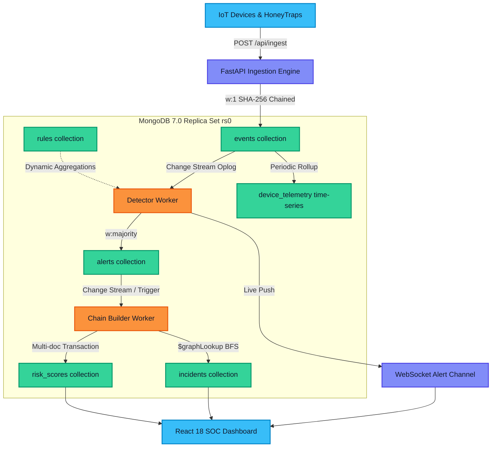

# HoneyGraph 🍯🕸️

**MongoDB-Native Threat Intelligence & Attack-Chain Reconstruction Engine for IoT Networks**  
*DBMS Course Project — RVCE Department of Computer Science & Engineering*

HoneyGraph is a defensive security platform built natively on MongoDB 7.0+. It ingests high-velocity IoT telemetry and honeypot traffic, chains events into tamper-evident per-device cryptographic hash chains, triggers real-time detection via MongoDB Change Streams, reconstructs multi-hop attack graphs with `$graphLookup`, and visualizes compromised device clusters and incidents on an analyst SOC dashboard.

---

## First setup after cloning

Install Docker Desktop, Python 3.10+ and GNU Make. Node.js is needed only for local frontend development; the frontend container installs its own dependencies.

```powershell
Copy-Item .env.example .env
python -m pip install -r backend/requirements.txt
```

Edit `.env` and replace every `CHANGE_ME` credential and JWT secret. Keep password values and MongoDB URI credentials consistent, URL-encoding URI passwords when needed. To match the addresses in this README, set `MONGO1_PORT=37017`, `BACKEND_PORT=18000`, and update the host-side `MONGODB_URI` to use port `37017`. Each teammate should use their own local configuration; Git does not contain the original credentials or database volumes.

For the guided presentation, see [the step-by-step demo](docs/GUIDED_DEMO.md) and the [complete explanation and demo guide](output/pdf/HoneyGraph_Complete_Project_Explanation_and_Demo_Guide.pdf). The guide also covers preparing an empty device inventory.

## ⚡ Quickstart (One Command)

To initialize the replica set, provision collections, seed detection rules, and run the complete end-to-end acceptance demo:

```bash
make up && make seed && make demo
```

*(On Windows hosts with GNU Make, `mingw32-make up && mingw32-make seed && mingw32-make demo`)*

Once running:
* **SOC Web Dashboard:** [http://localhost:5173](http://localhost:5173)
* **REST API & Swagger Docs:** [http://localhost:18000/docs](http://localhost:18000/docs)
* **MongoDB Replica Set:** `localhost:37017` (mongo1), `localhost:27018` (mongo2), `localhost:27019` (mongo3)

---

## 🔑 Local Login Configuration

> [!CAUTION]
> Configure your own local credentials in `.env` using `.env.example` as the template. The real `.env` and generated MongoDB keyfile are intentionally excluded from Git.

### Application Users (SOC Dashboard & REST API)
| Role | Username | Password | Permissions |
|---|---|---|---|
| **Security Admin** | `APP_ADMIN_USERNAME` | `APP_ADMIN_PASSWORD` | Rule authoring, scenario execution, tamper simulation, user management and incident triage |
| **SOC Analyst** | `APP_ANALYST_USERNAME` | `APP_ANALYST_PASSWORD` | View alerts, inspect chains and risk, run integrity checks and update incident status |

### Database Internal Service Principals (MongoDB RBAC)
| User | Database | Roles | Responsibility |
|---|---|---|---|
| `root` | `admin` | `root` | Cluster setup, keyFile replica set initialization |
| `ingest_svc` | `honeygraph` | `readWriteEvents` | Fast event ingestion and reading previous device hash head |
| `detect_svc` | `honeygraph` | `detectorRole` | Reads events/rules; writes alerts, incidents, risk scores |
| `rule_admin` | `honeygraph` | `ruleAdminRole` | Restricted read/write access to `rules` collection |
| `analyst` | `honeygraph` | `analystRole` | Read-only access across HoneyGraph collections |
| `tamper_demo` | `honeygraph` | `tamperDemoRole` | Intentionally scoped update/delete on `events` for demonstration |
| `api_svc` | `honeygraph` | `apiServiceRole` | Backend API operations, user authentication, incident updates |

---

## 🏗️ Architecture Overview



### Core Engineering Principles
1. **MongoDB-Native Detection & Correlation:** Threat detection is executed using native MongoDB aggregation pipelines rather than Python reimplementations.
2. **Detection-as-Data:** Rules are stored as documents in `rules`. Adding or modifying rules takes effect instantly without restarting worker processes.
3. **Defense-in-Depth Safety Model:** Rule pipelines undergo strict AST validation; dangerous write/code stages (`$out`, `$merge`, `$function`, `$where`, `$accumulator`) and cross-collection `$lookup` are rejected.
4. **Per-Device Hash Chains:** Events contain SHA-256 hashes linking to the device's previous event (`hash = SHA256(prevHash || canonical_json(event))`). Eliminates global lock contention and enables linear tamper pinpointing.
5. **Time-Series Workaround:** MongoDB time-series collections do not support change streams or multi-document transactions. HoneyGraph uses a regular collection for `events` (watched by change streams) and a time-series collection for `device_telemetry` rollups.

---

## 🎬 End-to-End Demo Script (`make demo`)

The automated demo (`python backend/benchmarks/demo_flow.py`) verifies the 8 core acceptance criteria against the live system:

1. **Step 1: Real-Time Alert Ingestion & Push**  
   Simulates 18 Mirai-style brute force login attempts; an alert (`R-BRUTE-01`) is generated via MongoDB change streams and pushed via WebSocket in **< 50 ms**.
2. **Step 2: Ordered Lateral Movement Incident**  
   Injects a multi-hop pivoting attack across internal devices. `$graphLookup` traverses the attack path and assembles the full lateral chain (`hops=[0, 1, 2, 3]`).
3. **Step 3: Zero-Downtime Rule Modification**  
   Creates a new custom detection rule (`R-LIVE-...`) at runtime via the API. Matching traffic is injected, and the new rule immediately fires without restarting the detector.
4. **Step 4: Geospatial Risk Map & Radius Aggregation**  
   Calculates decayed device risk scores and performs a `$geoWithin` spherical radius query around Bengaluru, identifying high-risk IoT nodes.
5. **Step 5: Cryptographic Tamper Pinpointing**  
   Demonstrates three tamper modes (`modified`, `missing`, `reordered`). The hash-chain verifier audits the chains and pinpoints the exact break positions.
6. **Step 6: Injection Attack Rejection**  
   Attempts to inject malicious `$out` and `$function` pipelines into the rule engine; the server-side validator rejects both with HTTP 422.
7. **Step 7: Role-Based Access Control (RBAC)**  
   Validates that the `analyst` role cannot access admin routes or mutate detection rules (HTTP 403 Forbidden).
8. **Step 8: Multi-Document Transactional Incident Lifecycle**  
   Triages an incident through its status transitions (`open -> triaged -> closed`), verifying that status history and audit actors are atomically updated.

---

## 🛠️ Available Makefile Commands

| Command | Action |
|---|---|
| `make up` | Generates mongo-keyfile, boots Docker containers (`mongo1`, `mongo2`, `mongo3`, `backend`, `detector`, `frontend`) |
| `make down` | Gracefully terminates and removes all running containers and networks |
| `make seed` | Initializes database schemas, validators, indexes, and seeds standard threat rules |
| `make simulate` | Generates 60 seconds of high-rate realistic IoT normal and attack traffic |
| `make test` | Executes full backend integration test suite (53 tests) and frontend component tests |
| `make demo` | Runs the automated 8-step SOC verification demo suite |
| `make bench` | Executes all 8 performance benchmarks and regenerates `docs/BENCHMARKS.md` |
| `make logs` | Streams live Docker Compose logs |
| `make mongosh` | Opens an interactive authenticated `mongosh` session on `mongo1` as root admin |

---

## 📊 Benchmark Summary

Tested on a standard Windows 11 laptop against a 3-node MongoDB 7 replica set in Docker Desktop (reproducible seed `104729`):

* **Bulk Ingestion:** **33,251 events/s** (plain) and **19,592 events/s** (with per-device SHA-256 hash chaining). Both far exceed the 5,000 eps target.
* **Indexed Query Execution:** **< 15 ms** on all 1M-event corpus indexes (`device_ts`: 9 ms, `src_ts`: 14 ms, `event_type_ts`: 9 ms, `alerts_actor_ts`: 2 ms).
* **Detection Latency:** **p50 = 200 ms**, **p95 = 460 ms**, **p99 = 536 ms** (target < 1,000 ms MET).
* **Detection Quality:** **100% precision, 100% recall** across all 7 threat scenarios.
* **Graph Recovery:** All 4 hops of the lateral movement chain recovered in exact sequence.
* **Storage Optimization:** Time-series columnar compression achieves a **3× reduction in storage** and **15× reduction in index footprint** vs regular collections.
* **Failover Resilience:** Primary failure elected a new primary in **6.69 s**; API ingestion auto-reconnected without worker restarts.

*(For detailed explain output, CSV files, and charts, see [docs/BENCHMARKS.md](docs/BENCHMARKS.md).)*

---

## 🔧 Troubleshooting

### 1. MongoDB Replica Set Not Initializing
If `mongo1`, `mongo2`, or `mongo3` report authentication errors on first boot:
```bash
docker compose logs mongo-init
```
Ensure that `secrets/mongo-keyfile` was generated with mode `0400`. The one-shot `keyfile-init` container automatically normalizes permissions in a Linux Docker volume to prevent Windows filesystem permission issues.

### 2. Port Conflicts
* The default Docker setup publishes `mongo1` on host port `37017` (to avoid conflicting with any native `mongod` listening on port `27017`), `mongo2` on `27018`, and `mongo3` on `27019`.
* The FastAPI backend runs on internal port `8000` (mapped to host port `18000` if port 8000 is occupied).
* The Nginx reverse proxy serves both the frontend and proxy API requests on port `5173`.
* If a port is in use, modify the port mapping in `.env`.

### 3. Change Streams Resume Token Lost
If the detector worker restarts after being offline for an extended duration, it resumes using the stored token from `system_state`. If the MongoDB oplog has rolled over, the worker automatically logs a warning and falls back to tailing from the current wall-clock time (`$currentDate`).

---

## 📜 Documentation Directory
* [docs/ARCHITECTURE.md](docs/ARCHITECTURE.md) — Comprehensive technical design, schemas, indexing, safety model, and relational comparison.
* [docs/REPLICATION_SHARDING.md](docs/REPLICATION_SHARDING.md) — Replica set configuration, majority write concern, CAP theorem analysis, and sharding design.
* [docs/BENCHMARKS.md](docs/BENCHMARKS.md) — Benchmark numbers, explain execution stats, charts, and methodology.
* [docs/PROGRESS.md](docs/PROGRESS.md) — Phase-by-phase implementation log, architectural decisions, and verification gates.
