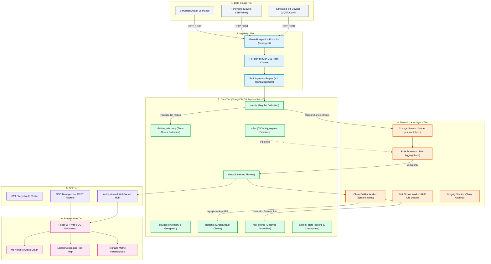
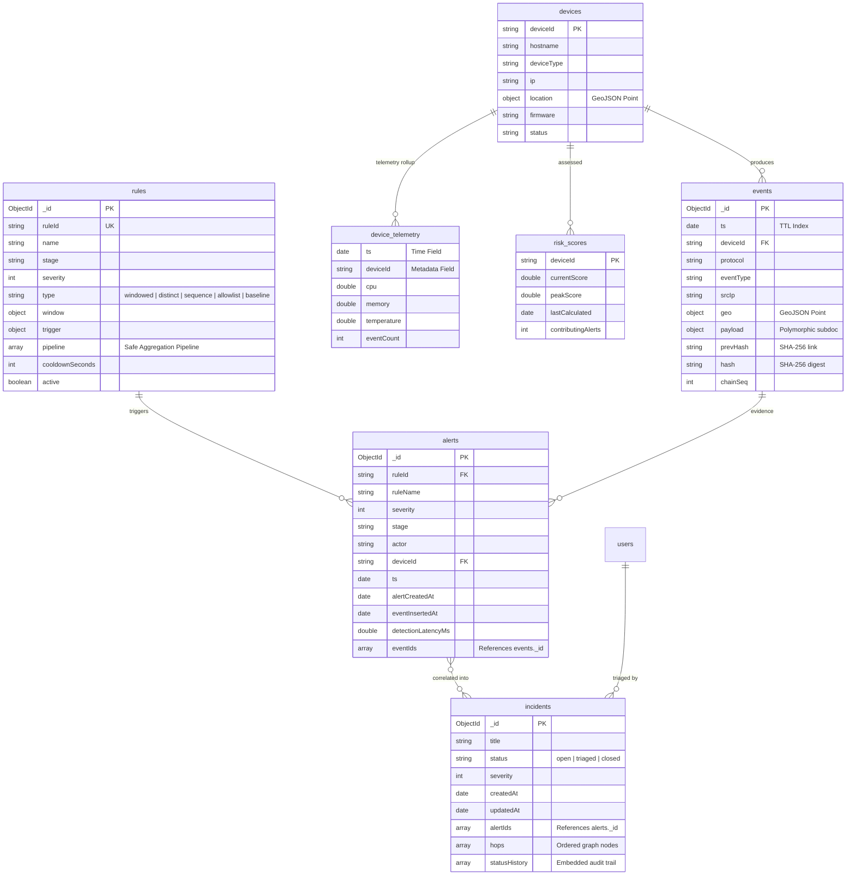
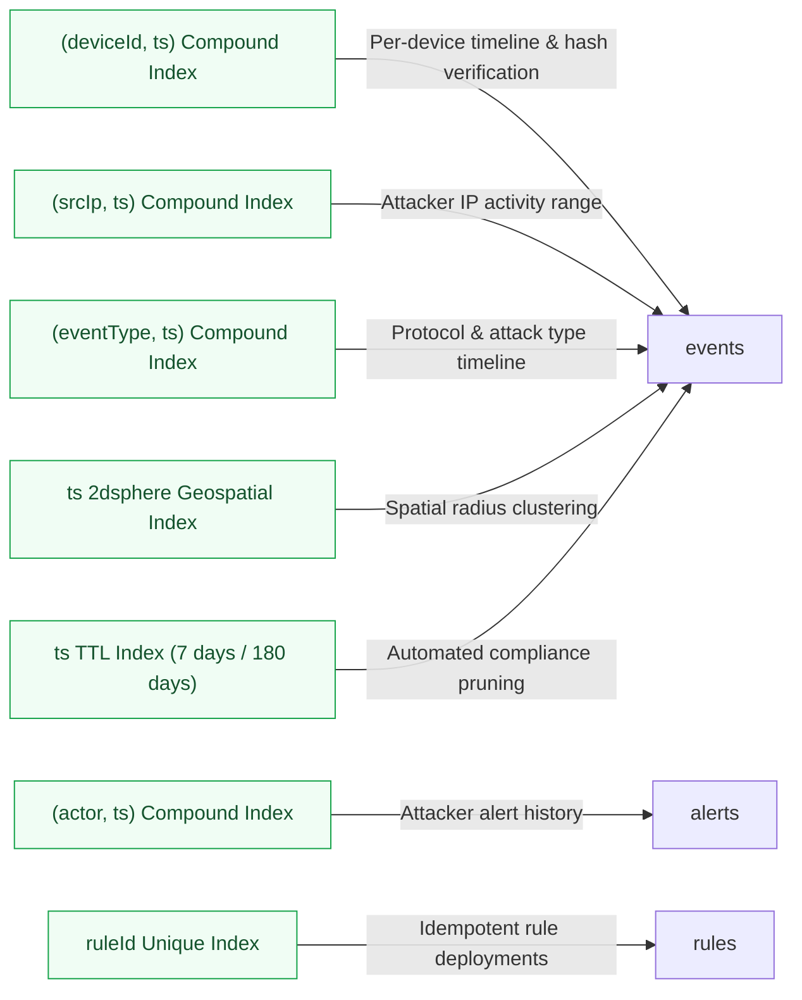
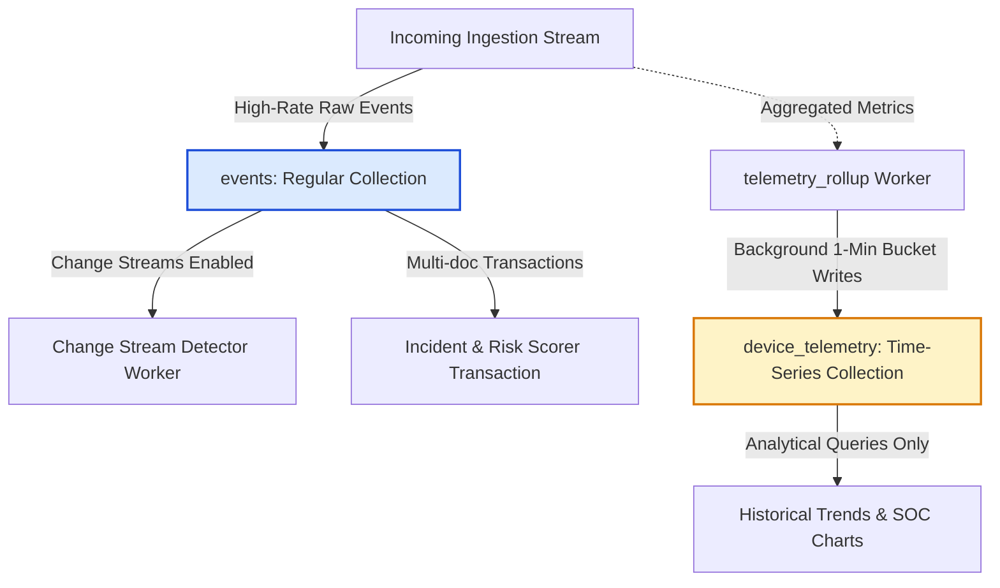
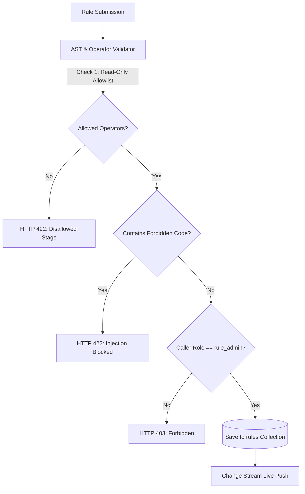

# HoneyGraph System Architecture

HoneyGraph is a defensive security and threat intelligence engine designed natively on MongoDB 7.0+. It provides real-time event ingestion, cryptographic tamper evidence, change-stream-driven threat detection, graph-based attack-chain reconstruction, and SOC analyst visualization for IoT environments.

---

## 1. Layered Architecture

HoneyGraph is structured into six discrete, decoupled architectural tiers:



### Tier Responsibilities

1. **Data Source Tier**: Simulated IoT hardware sensors, telemetry emitters, and Cowrie honeypots executing protocols across MQTT, CoAP, HTTP, SSH, and Telnet.
2. **Ingestion Tier**: High-throughput FastAPI endpoint. Maintains per-device cryptographic hash heads and performs bulk unordered inserts with `w:1` write concern.
3. **Data Tier**: 3-node MongoDB replica set (`rs0`) with internal keyFile authentication and custom least-privilege RBAC roles.
4. **Detection and Analytics Tier**: Asynchronous workers subscribing to change streams on `events` and `alerts`. Evaluates rules directly inside MongoDB via aggregation pipelines, reconstructs attack paths using `$graphLookup`, and applies exponential risk decay.
5. **API Tier**: Role-aware FastAPI application enforcing JWT bearer tokens with granular roles (`admin`, `analyst`) and WebSocket notification channels.
6. **Presentation Tier**: Modern React 18 single-page application rendering real-time push alerts, topological attack graphs, geospatial risk maps, and historical audit logs.

---

## 2. Document Model & Relationships



### Embedded vs. Referenced Rationale

| Data Relationship | Modeling Choice | Engineering Justification |
|---|---|---|
| **Event Payloads** | **Embedded** | IoT telemetry varies by protocol (`ssh` auth has `{user, attempts}`, `mqtt` has `{topic, clientId, action}`). Embedding polymorphic payloads within `events` allows self-contained atomic ingestion with zero JOIN overhead. |
| **Incident Status History** | **Embedded** | Status transitions (`open -> triaged -> closed`) include timestamp, status, and actor. Because an incident transitions fewer than 10 times in its lifecycle, embedding guarantees that the complete audit history is loaded in a single read. |
| **Alert to Events** | **Referenced (`eventIds: [ObjectId]`)** | Alerts reference 1 to 20 triggering events. Referencing keeps the `alerts` collection lightweight, prevents document unbounded growth, and allows independent query access. |
| **Incident to Alerts** | **Referenced (`alertIds: [ObjectId]`)** | Multiple alerts across multiple devices form an incident. Storing an array of alert ObjectIDs avoids duplicating full alert bodies. |
| **Device to Events** | **Referenced (`deviceId`)** | A single IoT device produces millions of events over its lifetime. Embedding events inside a device document would violate the 16 MB BSON limit within minutes. |

---

## 3. Indexing Strategy & Performance Rationale



### Index Rationale & Measured Benchmark Stats

1. **`{deviceId: 1, ts: 1}` on `events`**:
   * *Purpose:* Powers per-device forensic timelines and hash-chain verification.
   * *Measured Result:* Query scan on 1M events dropped from **611 ms** (1,000,000 docs examined) to **9 ms** (2,000 docs examined).
2. **`{srcIp: 1, ts: 1}` on `events`**:
   * *Purpose:* Enables rapid tracking of attacker IP activity across the entire fleet.
   * *Measured Result:* Query time dropped from **574 ms** to **14 ms**.
3. **`{eventType: 1, ts: 1}` on `events`**:
   * *Purpose:* Optimizes rule engine window evaluations for specific event triggers.
   * *Measured Result:* Query time dropped from **658 ms** to **9 ms** (3,334 docs examined).
4. **`{location: "2dsphere"}` on `devices` & `{geo: "2dsphere"}` on `events`**:
   * *Purpose:* Executes `$geoWithin` and `$centerSphere` spherical distance queries to identify compromised IoT hardware within geographic radius boundaries.
5. **`{ts: 1}` with `expireAfterSeconds`**:
   * *Purpose:* Automatic event purging to enforce CERT-In retention rules (default 7 days for dev, 180 days for production) without cron jobs. Indexes are updated dynamically using `collMod`.
6. **`{ruleId: 1}` Unique on `rules` & `{username: 1}` Unique on `users`**:
   * *Purpose:* Guarantees identity uniqueness and supports idempotent bulk rule deployments (`ReplaceOne(..., upsert=True)`).

---

## 4. Time-Series vs. Change-Streams vs. Transactions

### The MongoDB 7 Limitation

In MongoDB 7.0, **Time-Series collections do not support Change Streams or Multi-Document ACID Transactions**:
1. *Change Streams:* MongoDB stores time-series data internally in compressed columnar buckets (`system.buckets.collection_name`). The change-stream engine cannot listen on bucket compaction.
2. *Transactions:* Writes into time-series collections cannot be executed inside a multi-document session transaction.

### HoneyGraph's Architectural Workaround



* **`events` is a REGULAR Collection**:
  * Must support real-time Change Stream subscriptions so `detector.py` receives every event instantly through the oplog.
  * Must participate in multi-document transactions when correlating alerts and updating risk scores.
* **`device_telemetry` is a TIME-SERIES Collection**:
  * Used exclusively for minute-level metric rollups (`cpu`, `memory`, `temperature`, `eventCount`).
  * Yields a **3× storage compression ratio** (1.72 MiB vs 5.20 MiB for 200k docs) and a **15× smaller index footprint** (0.51 MiB vs 7.57 MiB).
  * Only queried for analytical dashboard graphs, never triggering detection alerts.

---

## 5. Per-Device Cryptographic Hash Chains

### Architecture

Rather than maintaining a single global blockchain (which would serialize all writes into a global lock), HoneyGraph implements an independent SHA-256 chain **per IoT device**:

$$\text{hash}_n = \text{SHA-256}(\text{hash}_{n-1} \parallel \text{canonical\_json}(\text{event}_n))$$

$$\text{hash}_0 = \text{"0"}^{64} \quad (\text{Genesis Hash})$$

```mermaid
graph LR
    subgraph Device 1 Chain
        D1E1[Event 1<br/>prevHash: 000...000<br/>hash: a1b2...] --> D1E2[Event 2<br/>prevHash: a1b2...<br/>hash: c3d4...] --> D1E3[Event 3<br/>prevHash: c3d4...<br/>hash: e5f6...]
    end
    subgraph Device 2 Chain (Parallel)
        D2E1[Event 1<br/>prevHash: 000...000<br/>hash: 1122...] --> D2E2[Event 2<br/>prevHash: 1122...<br/>hash: 3344...]
    end
```

### Concurrency Benefit
* Ingestion across 500+ devices runs with 100% parallelism without lock contention.
* Benchmark throughput reaches **19,592 events/s** with full hash verification.

### Limits & External Checkpointing
* **Linear Tamper Pinpointing:** If an attacker modifies or swaps an event at position $k$, the verifier recomputes hashes sequentially and pinpoints position $k$ as `modified` or `reordered`.
* **The Truncation Vulnerability (Tail Deletion):** If an adversary deletes the last $m$ events of a device chain, the remaining $1 \dots (n-m)$ events still form a mathematically valid chain! The chain links alone cannot prove that events were deleted from the tail.
* **The Solution (External Anchoring):** HoneyGraph periodically captures the state of all device heads, signs the snapshot, and anchors it externally in `checkpoints/YYYYMMDDHHMM.json` and `system_state`. When auditing, the verifier matches stored heads against the trusted external checkpoint anchor.

---

## 6. Rule Engine Safety Model

Detection rules are stored as JSON documents containing MongoDB aggregation pipelines. To prevent injection of arbitrary code or destructive operations by analysts or compromised accounts, HoneyGraph implements a strict multi-layer defense:



### Safety Controls

1. **Strict Stage Allowlist**: Only read-only pipeline stages are allowed:
   `$match`, `$group`, `$project`, `$sort`, `$limit`, `$addFields`, `$count`, `$bucket`, `$unwind`.
2. **Explicit Blocklist**: Dangerous stages that mutate data, execute JavaScript, or span arbitrary collections are blocked:
   * **Write stages:** `$out`, `$merge`
   * **Arbitrary code execution:** `$function`, `$where`, `$accumulator`
   * **Unrestricted cross-collection joins:** `$lookup`
3. **Template Placeholders:** Rules use strict sanitized parameter substitution (`{{srcIp}}`, `{{deviceId}}`, `{{eventId}}`) to prevent pipeline injection.
4. **RBAC Isolation:** The operational API service (`api_svc`) possesses no write grants on `rules`. Rule mutations require the dedicated `rule_admin` MongoDB role.

---

## 7. Architectural Evaluation: MongoDB Native vs. Relational Stack

| Architectural Dimension | MongoDB Native (HoneyGraph) | Relational Equivalent (e.g. PostgreSQL + Extensions) | Trade-Off Analysis |
|---|---|---|---|
| **Polymorphic Event Payload** | Native BSON documents validated via JSON Schema `$jsonSchema`. | Requires `JSONB` column or multiple child tables with foreign keys. | MongoDB JSON Schema provides native schema-per-protocol validation without table explosion. |
| **Real-Time Detection Trigger** | Native Change Streams (`db.events.watch()`) tailing the oplog with resume tokens. | Requires `LISTEN/NOTIFY` triggers or external CDC (Debezium + Kafka). | PostgreSQL `LISTEN/NOTIFY` drops events if consumers disconnect; Kafka adds significant infrastructure complexity. |
| **Attack Chain Graph Traversal** | Native `$graphLookup` aggregation operator in single query. | Requires Recursive Common Table Expressions (`WITH RECURSIVE`). | Recursive CTEs can match `$graphLookup` for shallow graphs, but `$graphLookup` supports depth limiting, cycles, and breadcrumb projections natively. |
| **Time-Series Telemetry** | Built-in Time-Series Collections with automatic columnar compression. | Requires TimescaleDB extension (`hypertable`). | TimescaleDB hypertable is extremely mature; MongoDB native time-series requires no third-party binary plugins but lacks transactions/change streams. |
| **Geospatial Risk Clustering** | Native `2dsphere` indexes with `$geoWithin` / `$centerSphere`. | Requires PostGIS extension (`geometry` type and GiST index). | PostGIS is functionally superior for complex GIS analysis; MongoDB native 2dsphere is ideal and sufficient for spherical radius and coordinate querying. |
| **Operational Simplicity** | **Single unified cluster** providing documents, change streams, graphs, time-series, and geospatial natively. | **Requires 4–5 distinct plugins** (TimescaleDB + PostGIS + pg_graphql + Debezium) to match full feature set. | A relational system can theoretically cover all needs via plugins; MongoDB provides unified, out-of-the-box coverage with lower operational maintenance overhead. |
