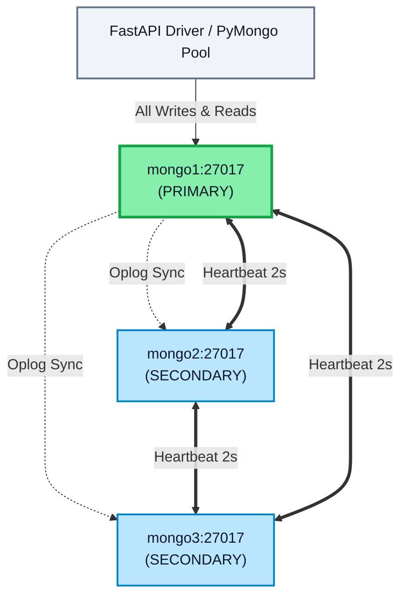
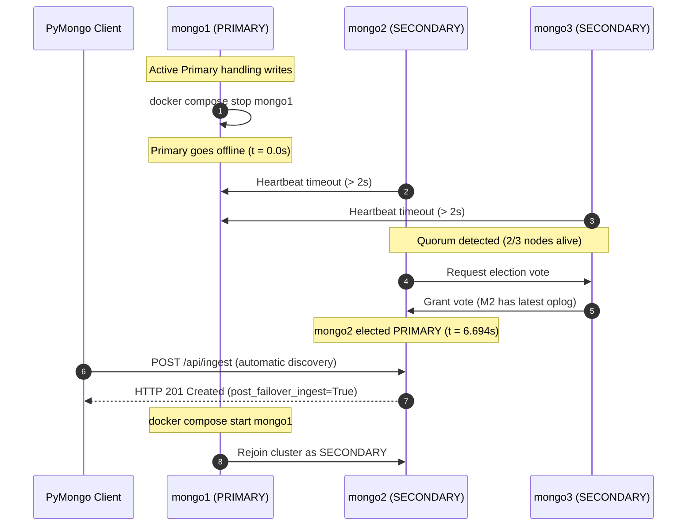

# HoneyGraph: High Availability, Replication & Sharding Analysis

This document details the high-availability architecture of HoneyGraph, evaluates majority write durability, reports measured failover performance, analyzes consistency under the CAP theorem, and presents a shard-key design for future enterprise scale.

> [!IMPORTANT]
> **Prototype Deployment Notice:** The current HoneyGraph prototype is deployed as a **3-node replica set (`rs0`)** and is **not sharded**. Sharding introduces router (`mongos`) and configuration server overhead that is unnecessary for a course project on a single laptop host. The sharding section below documents the horizontal scaling design.

---

## 1. Three-Node Replica Set (`rs0`)

HoneyGraph runs a high-availability MongoDB 7.0 replica set consisting of three members deployed across Docker containers:



### Replica Set Configuration
* **Members:** `mongo1` (priority 1), `mongo2` (priority 1), `mongo3` (priority 1).
* **Heartbeat Frequency:** Every 2 seconds (`heartbeatIntervalMillis: 2000`).
* **Election Timeout:** 10 seconds (`electionTimeoutMillis: 10000`).
* **Internal Security:** Inter-node authentication enforced via a shared cryptographic keyFile (`security.keyFile: /etc/mongo/keyfile`) with POSIX permission `0400` owned by `mongodb:mongodb` (999:999).
* **Consensus Model:** Modified Raft consensus where an election requires acknowledgment from a strict majority ($\lceil (N+1)/2 \rceil = 2$ out of 3 votes).

---

## 2. Write Concern Strategy: Performance vs. Durability

HoneyGraph employs a two-tier write concern policy matching the operational requirements of IoT telemetry vs. security incident tracking:

| Tier | Collection | Write Concern | Rationale | Performance & Durability Trade-off |
|---|---|---|---|---|
| **High-Throughput Ingestion** | `events` | `w:1` | Event ingestion must exceed 5,000 eps on resource-constrained hardware. | **Fast Path:** Returns as soon as the Primary acknowledges in memory/WAL. Measured rate: **33,251 events/s** (plain) and **19,592 events/s** (hash-chained).<br/>*Risk:* A sudden primary crash before oplog replication can lose the most recent unacknowledged batch. |
| **Security State & Incident Durability** | `alerts`, `incidents`, `risk_scores` | `w:majority` | Security alerts and SOC triage actions must never be rolled back. | **Safe Path:** Acknowledged only after replicating to at least 2 of the 3 replica set members ($\ge$ majority). Survives primary failure without data loss at the cost of ~2–3× latency. |
| **Atomic Multi-Doc Correlations** | `incidents` + `risk_scores` | `w:majority` (inside ACID transaction) | Creating an incident, linking its alerts, and updating device risk scores happens in one multi-document transaction. | Guarantees all-or-nothing atomicity across collections. |

---

## 3. Measured Replica-Set Failover Results

To measure election latency and post-failover recovery, the benchmark script [`failover.py`](file:///c:/Users/chira/OneDrive/Desktop/dbms(EL)/backend/benchmarks/failover.py) simulated an abrupt primary crash during active ingestion:



### Measured Benchmark Statistics
* **Pre-Failover Primary:** `mongo1`
* **Trigger Action:** `docker compose stop mongo1`
* **Election Duration:** **6.694 seconds** (well within normal 10–15 second window).
* **New Primary Elected:** `mongo2`
* **Driver Reconnect Latency:** Automatic via PyMongo replica set seed list discovery (`replicaSet=rs0`).
* **Post-Failover Write Success:** **True (HTTP 201 Created)** with zero application restarts.
* **Post-Test Re-stabilization:** `mongo1` restarted and cleanly rejoined as `SECONDARY`.

---

## 4. CAP Theorem Analysis

Under the Brewer's CAP theorem (Consistency, Availability, Partition tolerance), a distributed database network partition ($P$) requires trading off between Consistency ($C$) and Availability ($A$).

```mermaid
graph TD
    classDef net fill:#fee2e2,stroke:#ef4444,stroke-width:2px;
    classDef part1 fill:#dcfce7,stroke:#16a34a,stroke-width:2px;
    classDef part2 fill:#fef3c7,stroke:#d97706,stroke-width:2px;

    subgraph Cluster["Network Partition Event (P)"]
        subgraph SideA["Majority Partition (Quorum = 2)"]:::part1
            M2["mongo2 (Elected PRIMARY)"]
            M3["mongo3 (SECONDARY)"]
        end
        subgraph SideB["Minority Partition (Quorum = 1)"]:::part2
            M1["mongo1 (Isolated Former Primary)"]
        end
    end
```

### How HoneyGraph Behaves Under Partition: **CP (Consistency + Partition Tolerance)**

1. **Majority Partition Behavior (mongo2 + mongo3):**
   * Represents 2 out of 3 votes ($\ge$ majority).
   * Elects a new primary and accepts `w:majority` writes.
   * Remains **Consistent** and **Available**.
2. **Minority Partition Behavior (mongo1 isolated):**
   * Cannot maintain a heartbeat quorum with the majority.
   * `mongo1` immediately detects the loss of majority quorum and steps down from `PRIMARY` to `SECONDARY`.
   * Rejects all subsequent write operations with `NotWritablePrimaryError`.
3. **Split-Brain Prevention:**
   * Because a minority cannot elect a primary, **split-brain is mathematically impossible** in a 3-node replica set.
   * Clients connected to the minority side receive write errors until their driver discovers the majority primary.
4. **Conclusion:** HoneyGraph operates as a **CP system**, prioritizing data integrity and strict operational consistency over total availability during network partition events.

---

## 5. Horizontal Scaling & Shard-Key Analysis

If HoneyGraph expands from a 500-device course demonstration to an enterprise deployment ingesting tens of millions of events per hour across hundreds of thousands of IoT nodes, the database must be partitioned across shards.

```mermaid
graph TD
    classDef router fill:#ede9fe,stroke:#7c3aed,stroke-width:2px;
    classDef shard fill:#f0fdf4,stroke:#16a34a,stroke-width:2px;

    ROUTER["mongos Query Router"]:::router
    ROUTER -->|Compound Route {deviceId, ts}| SH1["Shard 1 (Replica Set 1)"]:::shard
    ROUTER -->|Compound Route {deviceId, ts}| SH2["Shard 2 (Replica Set 2)"]:::shard
    ROUTER -->|Compound Route {deviceId, ts}| SH3["Shard 3 (Replica Set 3)"]:::shard
```

### Evaluating Candidate Shard Keys for `events`

| Shard Key Candidate | Write Distribution Quality | Query Routing Efficiency | Verdict & Trade-off Analysis |
|---|---|---|---|
| **Monotonic Timestamp (`{ts: 1}`)** | **Extremely Poor (Hotspotting)** | Excellent for broad global time queries. | **REJECTED.** Monotonically increasing timestamps cause all incoming writes to target the single chunk holding `MaxKey` on one shard. The other shards remain idle, completely defeating the purpose of horizontal scaling. |
| **Hashed Device ID (`{deviceId: "hashed"}`)** | **Excellent (Even Distribution)** | Poor for multi-device time queries (scatter-gather). | **ACCEPTABLE BUT SUB-OPTIMAL.** Hashes distribute ingestion evenly across all shards with zero hotspots. However, querying global security alerts or time windows requires scatter-gather queries to every shard in the cluster. |
| **Compound (`{deviceId: 1, ts: 1}`)** | **Very Good (Balanced across devices)** | **Optimal for HoneyGraph access patterns.** | **RECOMMENDED.** HoneyGraph's primary operational queries are scoped per device: hash-chain verification, device incident graphs, and forensic timelines all filter by `deviceId`. The router targets a single shard directly, while `ts` provides range pruning within the shard. |

### Recommended Sharding Architecture

```javascript
// Enable sharding on database
sh.enableSharding("honeygraph");

// Shard events collection using compound key
sh.shardCollection("honeygraph.events", { "deviceId": 1, "ts": 1 });

// Shard alerts collection using compound key
sh.shardCollection("honeygraph.alerts", { "actor": 1, "ts": 1 });
```

### Why Sharding Was Omitted from the Prototype
1. **Infrastructure Footprint:** A minimal sharded cluster requires 2 shard replica sets (6 nodes) + 1 config replica set (3 nodes) + 2 `mongos` routers = **11 containers**, consuming > 6 GB RAM.
2. **Measured Laptop Throughput:** Our single 3-node replica set achieves **33,251 events/s**, which exceeds our project target of 5,000 eps by 6.6× without sharding complexity.
